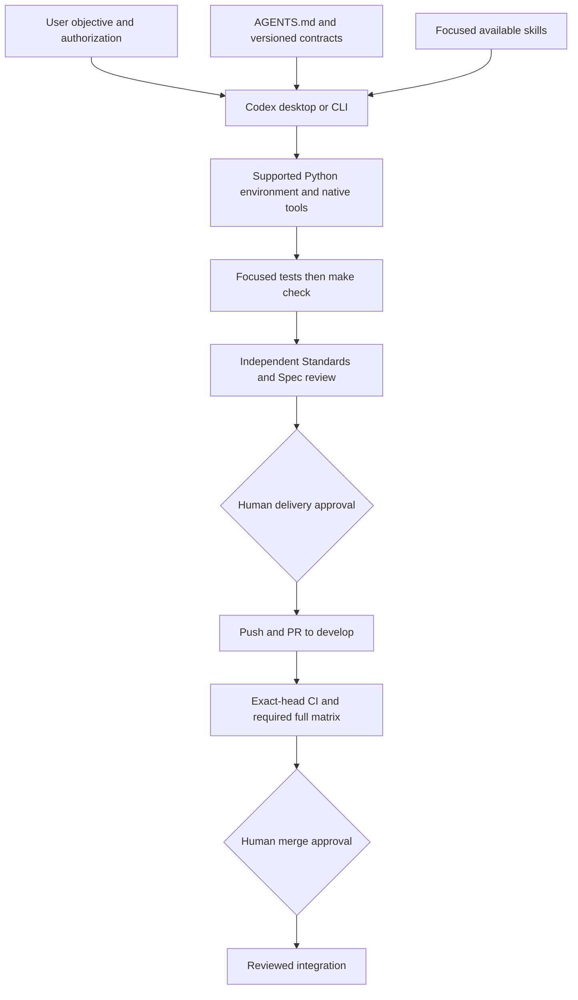

# Codex development harness

Date: 10 November 2026
Status: local setup and workflow maintenance; remote qualification pending

## Scope and current product gate

This maintenance does not advance the ten-feature train. Features 1–3 remain
integrated; feature 4 remains incomplete. The v1 preservation guarantee in
[contract296](296-partition-recovery-contract.md) remains binding. A new concrete
protocol must satisfy every [audit314](314-session-mutation-protocol-audit.md)
row before destructive session work continues. The FSRef routes remain rejected
by [evidence318](318-fsref-mutation-boundary-evidence.md), and profile315 remains
unselected. Discard, promotion, abandonment and retained execution stay disabled.
All ten features, clarity audit307 and engineering gate317 remain release gates.

## Architecture

Use the [contributor setup](../../CONTRIBUTING.md#setup-and-checks) as the
installation source of truth. Keep the existing Make interface and explicit
interpreter override; no new orchestrator, verification wrapper or runtime
dependency is introduced. The quality workflow now also checks the generated
command reference for documentation-only changes. Runtime CI and its manual
full-profile requirements remain as defined in [checkpoint305](305-tiered-ci-qualification.md).

## Capabilities and activation

For the optional planner/generator/evaluator workflow, see [checkpoint320](320-planner-generator-evaluator-workflow.md).

Codex CLI 0.160.0 and this desktop session expose native execution and review
capabilities. Subagent tools are available in this session; tool exposure alone
does not establish that a review ran. CLI configuration and desktop tool exposure
can differ. ChatGPT and local Codex sessions are not assumed to share unrestricted
files, permissions or state.

The audited machine already has personal procedures for module design
(`codebase-design`), independent review (`code-review`), diagnosis
(`diagnosing-bugs`), test-first work (`tdd`), research and writing instructions.
Use each only for its matching task; ordinary Python, SQL and backend work uses
native behavior and repository contracts. The ignored local `impeccable` skill
supports interface work. These personal and ignored files are not portable
repository dependencies. On another machine, verify availability before invoking
them; use the documented repository gates if a skill is unavailable. Introduce
a shared skill only when a repeated team procedure justifies maintaining it.

## Permissions and optional integrations

AGENTS.md expresses the workflow; sandbox permissions and repository protections
provide technical boundaries. Use read-only permissions for audits and bounded
workspace writes for implementation. The audited desktop session uses restricted
network access and automatic escalation review. Changing that policy requires
separate authorization. Human delivery approval is still required by the agent
contract; automatic escalation review is not proof of human approval.

No new MCP server or plugin is installed. Retain native shell/Git/gh tooling and
existing browser tools. Add browser test dependencies only for a repeatable
validation need. Documentation MCP, GitHub connections, database tools, Figma,
cloud deployment, API media and scheduling remain optional. Before connecting,
identify data sent to the service, account permissions, credentials, provider
charges and a concrete verification task. Keep service access outside Parison's
zero-custody core. Paid API use and security-policy changes need separate approval.

## Review and continuity

Start with `make context`, preserve owner edits, identify the contract and define
a checkable gate. Start a scoped branch from refreshed develop. Run affected
tests and `make check` with the supported interpreter before review. Review
Standards and Spec independently when available; record findings and fixes,
reviewed commit identity and affected retests. A skill being installed is not
a review result. Pushes and integrations require explicit authorization and
exact-head CI evidence; follow RELEASING.md separately for releases.

Replace changing state in [CURRENT.md](../CURRENT.md); keep historical evidence
in versioned notes. Record interpreter, commands, outcomes, skips and CI/review
identity. Label remote or historical claims separately from checks actually run.
Avoid parallel ARCHITECTURE, DECISIONS or HANDOFF files that duplicate the index
and existing contracts. Confidential research remains in ignored local-research.

## Before and after

| Area | Audited state | Result |
| --- | --- | --- |
| Local Python | Make selected Python 3.9.2; no project environment | Isolated Python 3.14 environment; explicit Make override documented |
| Contributor setup | Implicit interpreter; build tooling omitted | Supported interpreter, optional CI adapters and build tool documented |
| Agent delivery | Push step lacked explicit authorization condition | Explicit authorization boundary recorded |
| Docs-only quality | Lint and format checks | Generated-reference check added |
| Skills and integrations | Existing personal skills and desktop tools | Reused; no additional service installed |
| Product status | 3/10 features; feature4 blocked on protocol evidence | Same gate and frozen guarantees |

## Verification and rollback

Read-only GitHub API inspection on 10 November 2026 reported `protected: false`
for both develop (`ee7f44a`) and main (`a2884534`), with an empty repository
ruleset list. Human review and CI requirements therefore remain workflow
instructions rather than verified branch enforcement. Organization-level policy
was not inspected. No protection or permission settings were changed.

Local verification on this macOS arm64 host used Python 3.14.7 with Ruff 0.17.1,
build 1.6.1, jsonschema 4.26.0, Polars 1.44.2, openpyxl 3.1.5 and psycopg 3.3.6:

- Focused documentation/GitHub Actions suite: 14 tests passed.
- `make check PYTHON=.venv/bin/python`: passed all checks; 756 tests ran with 7 skips.
- `pip check`: no broken requirements; installed `parison --version`: 2.3.0.
- Modified quality workflow parsed successfully as YAML; modified documentation links resolve locally.
- `make docs-check PYTHON=python3` also passed using the supported system interpreter without optional project dependencies, matching the lightweight quality job.

The initial sandboxed install could not resolve PyPI; the approved network retry
installed only into .venv. The initial sandboxed full suite reported 14 loopback
bind permission errors; rerunning with local server permission produced the
passing result above. No tests were weakened. No new skill metadata or Codex
configuration was introduced. Build tooling is accessible; distribution building
was not run. At the local-setup handoff, independent review and remote CI had
not run, and no push, merge, release or protection change had been performed.
The owner subsequently authorized review and merge. Independent Standards and
Spec review cleared implementation `18a0b4a`; final-head review and CI evidence
belong in the harness PR to develop. An ordinary quality success is not
full-matrix qualification. No security-policy change is included.

Rollback the scoped tracked changes with a reviewed reverse patch or revert once
committed. Preserve unrelated edits, especially continuation297; avoid broad
checkout/reset commands. Deactivate and remove only the newly created .venv to
undo local dependency installation. No global Python packages, credentials,
Codex security settings or repository protections are changed by this setup.

## Example prompts

1. Implement this bounded contract; run focused tests and make check with the project interpreter. Stop before pushing.
2. Review this branch since COMMIT using independent Standards and Spec reviews; record the exact reviewed head.
3. Diagnose this failure and add a focused regression test under the current contract.
4. Validate this Workbench flow in the browser against its documented policy and evidence boundaries.
5. Update docs/CURRENT.md with the exact checkpoint, verification evidence and remaining gate.

## References

Official sources accessed 10 November 2026:

- [Configuration reference](https://learn.chatgpt.com/docs/config-file/config-reference): sandbox and approval controls are separate; settings must match the installed interface.
- [Build skills](https://learn.chatgpt.com/docs/build-skills): focused activation descriptions and required name/description metadata.

Design consequence: reuse the native harness and existing gates. Threats include
interpreter drift, unverified remote enforcement, leaking data through optional
connections and mistaking advisory instructions for enforcement. Non-goals are
a second orchestration framework, new product features, autonomous delivery,
automatic credential provisioning and relaxation of session preservation.
